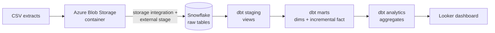
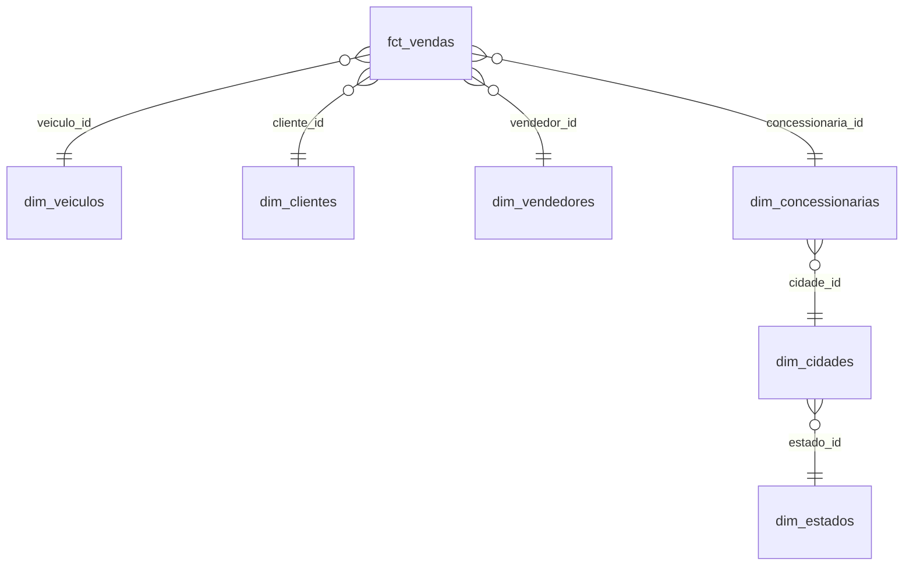
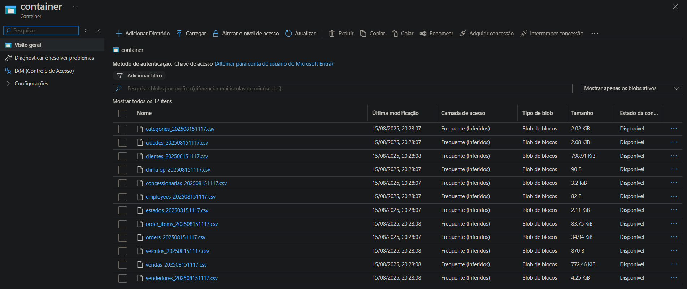
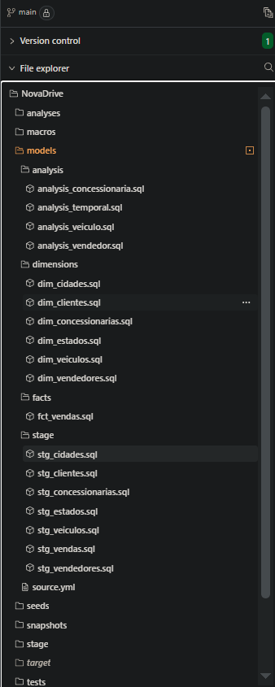
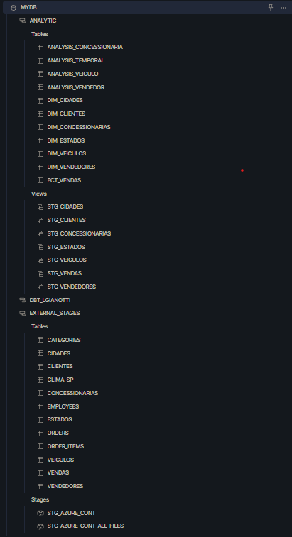
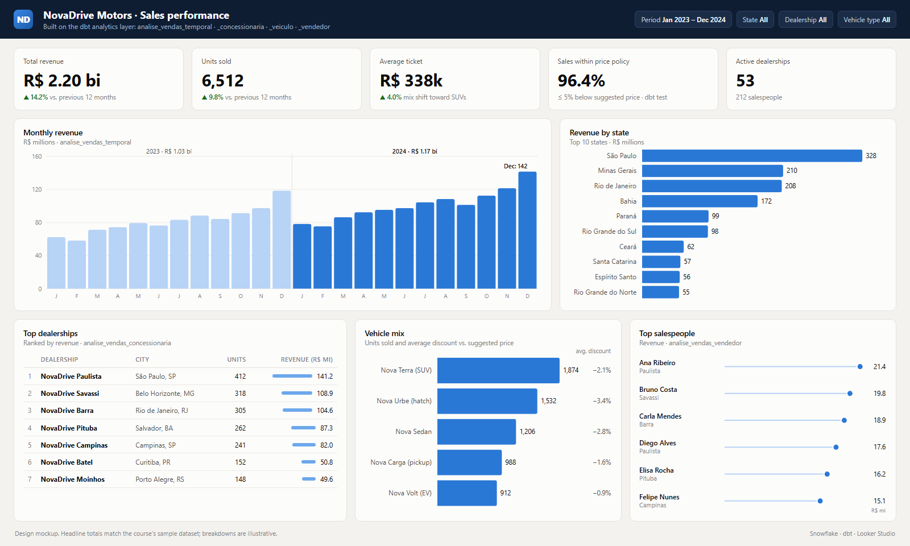

# NovaDrive: Azure → Snowflake → dbt → Looker

An end-to-end ELT pipeline for a fictional car dealership network (**NovaDrive**). Raw CSV extracts land in Azure Blob Storage, are loaded into Snowflake through an external stage, are modeled with dbt into a tested star schema, and are served to a Looker dashboard.


## Architecture



| Layer | Tool | What happens |
|---|---|---|
| Landing | Azure Blob Storage | Raw CSVs (sales, customers, vehicles, dealerships, salespeople, cities, states) stored in a container |
| Ingestion | Snowflake | Storage integration + external stage + `COPY INTO` load raw tables ([`snowflake/setup.sql`](snowflake/setup.sql)) |
| Staging | dbt (views) | Renaming, typing (`DECIMAL(10,2)`), `INITCAP` cleanup, `COALESCE` for missing update timestamps |
| Marts | dbt (tables) | Star schema: 6 dimensions + `fct_vendas`, built **incrementally** on `data_atualizacao` |
| Analytics | dbt (tables) | Pre-aggregated tables by dealership, salesperson, vehicle and month |
| Serving | Looker | Dashboard on top of the analytics layer |

## Data model



## Data quality

- **Generic tests** on every model: `unique` / `not_null` primary keys and `relationships` from the fact to each dimension ([`_staging.yml`](models/staging/_staging.yml), [`_marts.yml`](models/marts/_marts.yml)).
- **Business-rule test**: [`assert_sale_price_within_suggested_range`](tests/assert_sale_price_within_suggested_range.sql) flags any sale above the suggested price or more than 5% below it.
- **Referential integrity by design**: the fact uses inner joins to every dimension, so orphan sales never reach reporting.

## Project structure

```
├── dbt_project.yml
├── models/
│   ├── staging/            # stg_* views + sources
│   └── marts/
│       ├── dimensions/     # dim_* tables
│       ├── facts/          # fct_vendas (incremental)
│       └── analysis/       # analise_vendas_* aggregates
├── tests/                  # singular business-rule tests
├── snowflake/setup.sql     # storage integration, stages, raw tables, COPY INTO
└── docs/images/
```

## Running it

```bash
pip install dbt-snowflake
cp profiles.example.yml ~/.dbt/profiles.yml   # then set the SNOWFLAKE_* env vars
dbt build                                      # runs models and tests in DAG order
```

Run [`snowflake/setup.sql`](snowflake/setup.sql) first to create the storage integration, stages and raw tables (replace the `<placeholders>` with your Azure tenant and storage account).

## Screenshots

| Azure container | dbt project | Snowflake objects |
|---|---|---|
|  |  |  |

### Dashboard



> **Design mockup.** Each panel maps to one dbt analytics model (`analise_vendas_temporal`, `_concessionaria`, `_veiculo`, `_vendedor`), and the "sales within price policy" KPI comes from the business-rule test. Headline totals match the sample dataset; the breakdowns are illustrative. Source: [`docs/mockup/novadrive-dashboard.html`](docs/mockup/novadrive-dashboard.html).

## Related

- [CI-CD](https://github.com/GianottiLeo/CI-CD): GitHub Actions pipeline that tests and deploys dbt models to Snowflake dev/prod.

---
*Sample CSVs come from a Udemy course dataset; all names are fictional. The dbt project was originally developed in [NovaDrive](https://github.com/GianottiLeo/NovaDrive) and consolidated here.*
